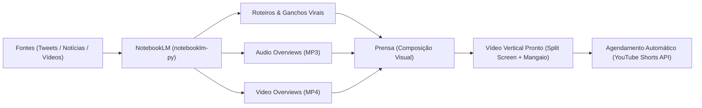

# 🧠 Guia de Integração: NotebookLM (Gemini Notebook) + Motores de Vídeo

Este documento descreve a arquitetura, configuração e boas práticas para integrar o **Google NotebookLM (Gemini Notebook)** ao pipeline de produção de conteúdo automatizado do `motores-video`.

---

## 📌 Por que o NotebookLM?

O NotebookLM é um motor de síntese e raciocínio profundo alimentado pelo **Gemini 1.5 Pro / Flash** com janela de contexto de até **2 milhões de tokens**.

### Vantagens Estratégicas para o Projeto:
1. **Zero Custo de Tokens de API:** Aproveita o processamento em nuvem da sua conta Google sem cobrança por requisição.
2. **Respostas Ancoradas (*Grounded*):** O Gemini analisa os materiais fornecidos (notícias, threads, PDFs, vídeos) e responde estritamente com base neles, incluindo citações exatas e evitando alucinações.
3. **Geração Multimodal Nativa:** Gera nativamente formatos de mídia completos:
   * **Audio Overviews:** Podcasts dinâmicos com duas vozes conversando em estilo rádio/debate natural.
   * **Video Overviews:** Formatos de vídeo sintetizados com base nos cadernos.
   * **Roteiros e Ganchos:** Resumos, perguntas, tabelas e roteiros prontos para redes sociais.

---

## 🛠️ Biblioteca Adotada: `notebooklm-py`

Como a Google API oficial para o NotebookLM é restrita a contratos corporativos do Google Workspace Enterprise, usamos a biblioteca de ponta da comunidade:
* **Repositório:** [`teng-lin/notebooklm-py`](https://github.com/teng-lin/notebooklm-py)
* **Recursos:** API Python completa, CLI avançada e suporte a MCP Server (Model Context Protocol).

---

## 🔄 Fluxo de Integração no Pipeline `motores-video`



1. **Ingestão:** Adiciona URLs de tweets, transcrições de vídeos ou notícias em um caderno temático.
2. **Síntese:** O NotebookLM gera o roteiro estruturado com gancho (hook), desenvolvimento e chamada para ação (CTA).
3. **Exportação:** O áudio ou vídeo gerado é baixado programaticamente para a pasta local (`cenas/` ou `saida/`).
4. **Pós-produção na Prensa:** A Prensa aplica o recorte vertical 9:16, a animação inferior do Mangaio para retenção, legendas dinâmicas e trilha sonora.
5. **Distribuição:** O script [`ferramentas/programar_shorts.py`](file:///c:/LIA/motores-video/ferramentas/programar_shorts.py) ou [`ferramentas/atualizar_shorts.py`](file:///c:/LIA/motores-video/ferramentas/atualizar_shorts.py) publica e agenda o vídeo no YouTube Shorts.

---

## 🚀 Instalação e Configuração

### 1. Instalação do Pacote
Instale o pacote com suporte a navegador (necessário para o login Playwright):
```bash
pip install "notebooklm-py[browser]"
```

### 2. Autenticação Inicial (Uma única vez)
Execute o comando de login no terminal:
```bash
notebooklm login
```
* Uma janela do navegador será aberta.
* Faça login com a sua conta Google.
* As credenciais da sessão são salvas com segurança no arquivo local `~/.notebooklm/storage_state.json`.

Para testar se a autenticação está ativa:
```bash
notebooklm auth check --test
```

### 3. Autenticação em Ambientes Sem Interface (Opcional / Servidores)
Para automações em servidores headless ou CI/CD, você pode exportar a variável de ambiente:
```bash
export NOTEBOOKLM_AUTH_JSON='{"cookies": ...}'
```

---

## 💻 Comandos Principais da CLI

### Cadernos e Fontes:
```bash
# Criar um caderno temático
notebooklm create "Virais Semana 42"

# Adicionar fontes (links, vídeos do YouTube, PDFs)
notebooklm source add "https://noticias.exemplo.com/artigo-viral"
notebooklm source add "https://www.youtube.com/watch?v=EXEMPLO"
notebooklm source add "caminho/para/documento.pdf"

# Listar cadernos existentes
notebooklm list
```

### Geração de Mídia e Conteúdo:
```bash
# Gerar podcast em áudio (Audio Overview)
notebooklm generate audio

# Gerar vídeo (Video Overview)
notebooklm generate video

# Gerar roteiro/relatório estruturado
notebooklm generate report --format briefing-doc
```

### Download de Artefatos Gerados:
```bash
# Baixar áudio do podcast para a pasta de saídas
notebooklm download audio --output saida/audio_podcast.mp3

# Baixar vídeo gerado
notebooklm download video --output saida/video_base.mp4

# Baixar roteiro em Markdown
notebooklm download report --output saida/roteiro.md
```

---

## 🐍 Exemplo de Uso em Script Python

Você pode importar a biblioteca diretamente em scripts dentro de `ferramentas/`:

```python
import asyncio
from notebooklm import NotebookLMClient

async def gerar_conteudo_viral():
    async with NotebookLMClient() as client:
        # 1. Cria ou seleciona o caderno
        notebook = await client.create_notebook("Roteiros Virais")
        
        # 2. Adiciona as fontes
        await client.add_source_url(notebook.id, "https://link-da-noticia.com")
        
        # 3. Pede um roteiro de Shorts com ganchos fortes
        resposta = await client.ask(
            notebook.id,
            "Crie um roteiro de 45 segundos para TikTok/YouTube Shorts em primeira pessoa, "
            "com gancho de alta retenção nos primeiros 3 segundos."
        )
        print("Roteiro Gerado:\n", resposta.text)
        
        # 4. Dispara a geração de áudio
        await client.generate_audio(notebook.id)
        
        # 5. Baixa o arquivo de áudio
        await client.download_audio(notebook.id, "saida/podcast_gerado.mp3")

if __name__ == "__main__":
    asyncio.run(gerar_conteudo_viral())
```

---

## ⚠️ Boas Práticas e Segurança

1. **Conta Google Dedicada:**
   * Recomenda-se utilizar uma conta Google secundária dedicada à automação de conteúdo, preservando a conta pessoal principal contra eventuais limitações de automação web.
2. **Controle de Taxa (*Rate Limits*):**
   * O NotebookLM web impõe limites caso muitas gerações pesadas de áudio/vídeo sejam disparadas simultaneamente. Execute em filas sequenciais respeitando intervalos de 1 a 2 minutos entre gerações.
3. **Privacidade e Versionamento:**
   * O arquivo `storage_state.json` e a pasta `~/.notebooklm/` contêm cookies de sessão e **nunca devem ser commitados no Git** (já adicionados ao `.gitignore`).
